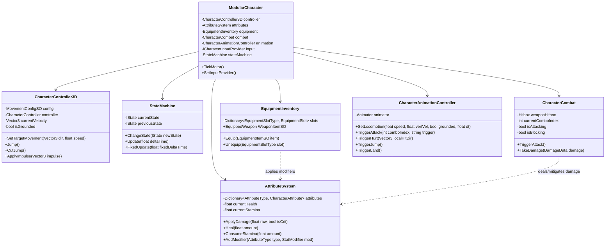

# Architecture Guide: Modular 3D Character System

This document outlines the architectural patterns, component interactions, mathematical formulations, and performance considerations underlying the **Modular 3D Character System**.

---

## 1. Architectural Philosophy

The character system is built on four core software engineering principles:
1. **Composition over Inheritance**: Game logic is segregated into discrete, single-responsibility components (`CharacterController3D`, `AttributeSystem`, `EquipmentInventory`, `CharacterCombat`, `CharacterAnimationController`).
2. **Data-Driven Configuration**: Gameplay balance variables (movement curves, base stats, equipment modifiers, weapon combos) reside in Unity `ScriptableObject` assets outside code, allowing immediate designer iterations without code recompilation.
3. **Deterministic State Orchestration**: A finite state machine decouples locomotion and combat transitions from the physical motor.
4. **Zero Runtime Garbage Collection**: All per-frame calculations (`Update` / `FixedUpdate`) operate without heap allocations, utilizing cached hashes, pre-instantiated state singletons, and non-allocating physics buffers.

---

## 2. System Architecture Diagram



---

## 3. Animation State Machine Flowchart

```mermaid
stateDiagram-v2
    [*] --> Idle

    state "Locomotion Subsystem" as Locomotion {
        Idle --> Walk : Move Input > 0
        Walk --> Idle : Move Input == 0
        Walk --> Sprint : Sprint Held & Stamina > 0
        Sprint --> Walk : Sprint Released or Stamina Empty
        Sprint --> Idle : Move Input == 0
    }

    state "Airborne Subsystem" as Airborne {
        Idle --> Jump : Jump Triggered
        Walk --> Jump : Jump Triggered
        Sprint --> Jump : Jump Triggered
        Jump --> Fall : Apex Reached (Vy <= 0)
        Idle --> Fall : Ledge Walkoff (!IsGrounded)
        Walk --> Fall : Ledge Walkoff (!IsGrounded)
        Sprint --> Fall : Ledge Walkoff (!IsGrounded)
        Fall --> Land : Ground Contact
        Land --> Walk : Move Input > 0 (Cancel)
        Land --> Idle : Timer Expired (0.15s)
    }

    state "Combat Subsystem" as Combat {
        Idle --> Attack : Attack Triggered & HasStamina
        Walk --> Attack : Attack Triggered & HasStamina
        Sprint --> Attack : Attack Triggered & HasStamina
        Attack --> Attack : Buffered Attack within Combo Window
        Attack --> Idle : Combo Finished / Timeout
        Idle --> Block : Block Held
        Walk --> Block : Block Held
        Block --> Idle : Block Released
    }

    state "Reaction Subsystem" as Reactions {
        [*] --> Hurt : TakeDamage (Interrupt)
        Hurt --> Idle : Stun Timer Expired (0.35s)
        Hurt --> Death : Health <= 0
        Attack --> Hurt : Interrupted by Hit
        Block --> Hurt : Guard Broken (Stamina <= 0)
        Idle --> Death : Health <= 0
        Walk --> Death : Health <= 0
    }
```

---

## 4. Kinematics & 3D Math Formulations

### Camera-Relative Movement
Planar input $I = (x_{in}, y_{in})$ is projected onto the camera's horizontal gaze plane:
$$V_{fwd} = \text{Normalize}(C_{forward} - (C_{forward} \cdot U_{up}) U_{up})$$
$$V_{right} = \text{Normalize}(C_{right} - (C_{right} \cdot U_{up}) U_{up})$$
$$D_{move} = \text{Normalize}(V_{fwd} \cdot y_{in} + V_{right} \cdot x_{in})$$

### Slope Projection & Traversability
Given ground surface normal $\vec{n}$:
$$\theta_{slope} = \arccos(\vec{n} \cdot \vec{u}_{up})$$
If $\theta_{slope} \le \theta_{max}$, movement aligns along the contact plane:
$$\vec{d}_{slope} = \vec{d}_{move} - (\vec{d}_{move} \cdot \vec{n}) \vec{n}$$
If $\theta_{slope} > \theta_{max}$, character slides down the slope:
$$\vec{v}_{slide} = \text{Normalize}(\vec{g} - (\vec{g} \cdot \vec{n}) \vec{n}) \cdot v_{slideSpeed}$$

### Jump Launch Velocity & Cut
To reach desired apex height $h$ under gravity magnitude $g$:
$$v_{0} = \sqrt{2 \cdot g \cdot h}$$
When the player releases the jump button early:
$$v_{y} \leftarrow v_{y} \cdot \mu_{cut} \quad (\mu_{cut} = 0.5)$$

---

## 5. Data-Driven Stat Calculation Formula

Attribute values are calculated with a dirty-flag cached formula:
$$\text{Value} = \left(\text{BaseValue} + \sum \text{FlatModifiers}\right) \times \left(1 + \sum \text{PercentageModifiers}\right)$$

### Defense Mitigation Formula
Damage taken from combat strikes is mitigated via hyperbolic scaling:
$$\text{DamageEffective} = \max\left(1, \text{DamageRaw} \times \frac{100}{100 + \text{Defense}}\right)$$
This formula ensures defense yields diminishing returns without granting complete invulnerability.

---

## 6. Performance Optimization Architecture

1. **Zero Runtime GC**:
   - Physics queries use `Physics.SphereCastNonAlloc` and `Physics.OverlapSphereNonAlloc` with preallocated buffers.
   - States are instantiated once in `CharacterContext` and reused indefinitely across transitions.
2. **Precomputed Animator Hashes**:
   - `AnimationHashIDs` caches all hashes (`Animator.StringToHash`) at static initialization.
3. **Decoupled Input Provider**:
   - `ICharacterInputProvider` allows seamless swapping between `PlayerCharacterInput` and `AICharacterInput`, enabling hundreds of active characters on screen without UI or player-camera bottlenecks.
